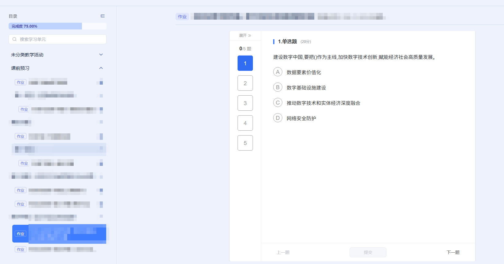

# yuketang-skill

雨课堂（yuketang.cn）习题自动作答技能包，供支持 Skill 机制的 AI 助手使用（WorkBuddy / Claude Code 等）。

核心思路：**脚本干机械活，大模型只识别答案。**

```
collect（脚本截图取题） → 识别（大模型出 answers.json） → apply（脚本点选提交） → report（脚本抓总分）
```

一份 20 题作业，大模型调用从 20~40 次降到 **1 次批量识题**，全程约 2 分钟。

## 在哪个页面生效

本技能只作用于雨课堂的**习题/作业作答页**，也就是下面这个界面：



页面结构与本技能的对应关系：

| 页面区域 | 脚本怎么用 |
|---|---|
| 左侧「目录」 | 只用来确认当前在课程/作业列表里，不做任何操作 |
| 中间「展开 »」+ 题号面板 | **按题号点击直达某一题**，这是主要的切题方式（比点「下一题」安全得多） |
| 右侧题干 / 选项 | 截图交给大模型识题；选项按 `label.el-radio / label.el-checkbox` 点选 |
| 底部「上一题 / 提交 / 下一题」 | 仅作兜底翻页；提交后页面会自动跳到下一题 |

不适用于：课程视频播放页、直播页、考试（监考）页、讨论区等其它页面。

## 特性

- **开箱自检**：`bootstrap.py` 自动检查 Python、安装 playwright、挑浏览器、起调试端口
- **多浏览器**：Chrome / Edge / Brave / Chromium 均可（Chromium 系共用 CDP 协议）
- **零 LLM 操作**：切题、点选项、提交、抓分全在本地脚本完成
- **遇验证码即停**：不做任何破解，截图存证后提示人工处理

不支持 Firefox / Safari —— 它们没有 CDP 接口。

## 快速开始

```bash
# 1. 环境自检与准备（会重启浏览器，未保存标签会丢）
python scripts/bootstrap.py

# 2. 指定浏览器 / 端口（可选）
python scripts/bootstrap.py --browser edge --port 9333
```

看到类似输出即就绪：

```json
{"python":"3.8.3","playwright":true,"browser":"Google Chrome","cdp":"Chrome/156.0.8078.80","port":9333}
```

然后在支持 Skill 的客户端里导入本目录，对助手说：

> 用 yuketang-auto-answer 完成这个作业：https://www.yuketang.cn/ai-workspace/lms-graph/.../exercise/xxxx

## 手动执行四个阶段

```bash
PY=python                                    # 换成能跑 playwright 的解释器
URL="https://www.yuketang.cn/ai-workspace/lms-graph/<cid>/exercise/<eid>?node_id=...&is_chapter=1"
RUN=./run_<eid>

# A. 采题（零 LLM）：读顶部计数器拿总题数，点左侧题号直达逐题截图
$PY scripts/ykt_executor.py --phase collect --url "$URL" --run-dir "$RUN"

# B. 识别：查看 $RUN/shots/q*.png，写出 $RUN/answers.json
#    {"answers":[{"index":1,"type":"单选","answer":["B"],"confidence":"high","reason":"…"}]}

# C. 作答（零 LLM）：点选 + 提交，提交后页面自动跳下一题
$PY scripts/ykt_executor.py --phase apply --run-dir "$RUN" --answers "$RUN/answers.json"

# D. 抓分（零 LLM）：进成绩单读「作业得分 X/Y」
$PY scripts/ykt_executor.py --phase report --run-dir "$RUN"
```

常用参数：`--resume` 断点续跑，`--only 3,7,9` 只跑指定题，`--cdp http://127.0.0.1:9444` 换端口。

## 目录结构

```
SKILL.md                 技能主文档（执行流程、页面机制、异常处理）
references/playbook.md   数据契约、脚本要点、排障表
scripts/bootstrap.py     环境自检与自动准备
scripts/browser_env.py   浏览器适配层（Chrome/Edge/Brave/Chromium）
scripts/ykt_executor.py  执行器：collect / apply / report
scripts/cdp_watchdog.py  调试端口保活
scripts/start_cdp_browser.cmd  双击启动带调试端口的浏览器
```

## 工作原理要点

| 机制 | 说明 |
|---|---|
| 题面位置 | 在 iframe 内，必须进入对应 frame 操作 |
| 跳题方式 | 点左侧题号面板直达，**不要逐题点「下一题」**（最容易触发人机验证） |
| 选项点击 | toggle 语义，必须先读 `is-checked`，只点差额 |
| 提交 | 提交后自动跳下一题，得分统一在 report 读 |
| 验证码 | 遮罩 `#homework-automation-risk-challenge` 出现即停止并提示人工处理 |
| 调试端口 | 默认 9333；Chrome/Edge 136+ 必须用副本配置目录才能开端口 |

更多细节见 `SKILL.md` 与 `references/playbook.md`。

## 注意事项

- 本工具仅供学习自动化技术、完成**自己**的课程练习使用，请遵守所在学校与平台的使用规定。
- 不代填任何账号密码：需要登录时请在浏览器里手动登录。
- 脚本会关闭并重启浏览器以开启调试端口，注意先保存工作。
- 平台随时可能调整页面结构或风控策略，脚本可能需要相应更新。

## License

MIT
